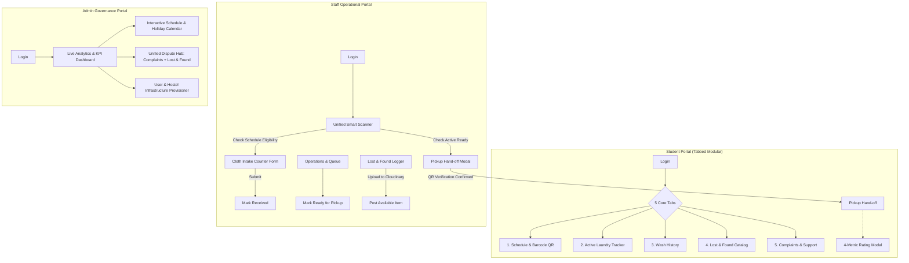

# SHLMS (V-Wash) — Frontend Project Context

_Source of truth for goals, scope, and constraints. Captured from the kickoff interview on 2026-10-08 and updated with verified UI flow architecture & backend diagnostics._

---

## 1. What We Are Building

A production-ready React frontend for the **Smart Hostel Laundry Management System** (a.k.a. V-Wash), replacing the prototype with a fully routed, secure web client wired to the Express/PostgreSQL backend (`SHLMS/Backend`).

- **Context**: College SWE project demo & submission (graded). High reliability and complete end-to-end user flows take precedence over superficial feature sprawl.
- **Frontend Owner**: Hirthick Srinivaasan V B (24BRS1281).
- **Domain Scale**: ~3,000-student hostel, round-robin laundry groups (configured by room ranges), status progression `received → ready_for_pickup → delivered`, identified physically by QR/barcodes.

---

## 2. Core Decisions & UI Flow Architecture

| Topic | Decision |
| --- | --- |
| **End Goal** | Full React client connected to the real backend API with real-time feedback & session continuity |
| **Stack** | **Vite + React + React Router** (no SSR). Tailwind CSS, lucide-react, Recharts, HTML5 QR/Barcode scanner |
| **Portals in Scope** | **Student**, **Laundry Staff**, and **Administrator** |
| **Student UI Model** | **Tabbed Modular Portal**: 5 distinct tabs (`Schedule & QR`, `Active Laundry Tracker`, `Wash History`, `Lost & Found`, `Complaints & Support`) |
| **Staff Counter Model**| **Unified Smart Scanner**: A single camera/barcode scanner interface that auto-detects context (ready clothes → pickup hand-off confirmation; scheduled today → cloth intake counter; unscheduled → reject) |
| **Admin UI Model** | **Interactive Visual Calendar** (for round-robin schedules and holiday freezes) + **Unified Dispute Hub** (two-column dashboard for Complaints & Lost-and-Found claims) |
| **Pickup & Feedback** | **Instant QR Pickup Handshake + Prompted 4-Metric Rating**: Staff scans QR to mark `delivered`, instantly pushing a notification and 4-star metric modal to the student |
| **Design Language** | Stripe-style minimalist aesthetic (high contrast tokens, slate-neutral cards, subtle micro-animations) |
| **QR Scanning** | Real camera stream via device scanner **plus** manual barcode input fallback for testing/kiosk mode |
| **User Provisioning** | **Admin Provisioned**: Admin manages staff and students (barcodes formatted `VW-STU-...`) |
| **Cloud Storage** | **Cloudinary API** integrated for photo evidence in complaints and lost-and-found items |

---

## 3. Verified System Flow & Action Cycles

### 3.1 Student Action Cycle
1. **Schedule & QR Tab**:
   - Fetches `GET /api/v1/schedules/my-schedule` & `GET /api/v1/schedules/today`.
   - Displays real-time eligibility banner ("Your turn today" vs "Next scheduled: [Date]").
   - Renders high-contrast barcode/QR Code card derived from `user.barcodeValue`.
2. **Active Tracker Tab**:
   - Fetches `GET /api/v1/laundry/my-laundry?status=active`.
   - Visual 3-stage progress bar: `Received` ➔ `Ready for Pickup` ➔ `Delivered`.
   - Details breakdown: shirts, pants, bedsheets, logged timestamp.
3. **Wash History Tab**:
   - Fetches `GET /api/v1/laundry/my-laundry` (all records).
   - Displays past orders, item totals, and completed ratings (`GET /api/v1/feedback/my-feedback`).
4. **Lost & Found Tab**:
   - Fetches `GET /api/v1/lost-found?status=available`.
   - Grid with item photos (Cloudinary), category, color, found date.
   - 1-click "Claim Item" modal (`POST /api/v1/lost-found/:id/claim`) + claim status tracker.
5. **Complaints Tab**:
   - Form selecting laundry record, category (`missing_clothes`, `damaged_clothes`, etc.), description, and Cloudinary photo attachment (`POST /api/v1/complaints`).
   - Resolution tracker showing `adminRemarks`.
6. **Pickup & Feedback Cycle**:
   - On staff marking delivery, prompt opens with 4 ratings: Cleanliness (1-5), Timeliness (1-5), Staff Service (1-5), Overall (1-5), plus comments (`POST /api/v1/feedback`).

### 3.2 Staff Action Cycle
1. **Unified Smart Scanner**:
   - Single scan interface (camera + barcode string).
   - **Branch 1 (Ready Clothes)**: If student has laundry in `ready_for_pickup`, opens **Pickup Confirmation**. Staff taps "Verify & Deliver" ➔ calls `POST /api/v1/laundry/verify-pickup` and `PATCH /api/v1/laundry/:id/deliver`.
   - **Branch 2 (Intake Eligible)**: If not ready, checks `POST /api/v1/laundry/verify-submission`. If eligible, opens **Cloth Counter Form** with item increments ➔ calls `POST /api/v1/laundry/submit`.
   - **Branch 3 (Ineligible / Duplicate)**: Displays error alert ("Wrong group today" or "Already submitted").
2. **Operational Queue & Status**:
   - `GET /api/v1/laundry/today-queue` lists expected vs submitted students.
   - Staff updates status from `received` to `ready_for_pickup` (`PATCH /api/v1/laundry/:id/status`).
3. **Lost & Found Logger**:
   - Quick form to record unclaimed clothes with camera photo upload to Cloudinary (`POST /api/v1/lost-found`).

### 3.3 Admin Action Cycle
1. **Interactive Visual Calendar**:
   - Monthly calendar displaying assigned laundry groups across dates.
   - "Generate Schedule" wizard (`POST /api/v1/schedules/generate`).
   - "Mark Holiday" tool (`POST /api/v1/schedules/holidays`) — automatically preserves rotation order.
2. **Unified Dispute Hub**:
   - Two-column view:
     - **Complaints**: Image preview modal, laundry history context, resolution note input, and Approve/Reject (`PATCH /api/v1/complaints/:id/status`).
     - **Lost & Found Claims**: Compares claim description with original photo for verification (`PATCH /api/v1/lost-found/claims/:id/status`).
3. **Hostel & User Provisioning**:
   - Configures blocks, floors, rooms, and laundry group room ranges (`POST /api/v1/hostels`, `POST /api/v1/laundry-groups`).
   - Admin-creates staff and bulk-provisions students with auto-generated barcode keys (`POST /api/v1/users`).

---

## 4. Environment & Integration Diagnostics

| Component | Status & Configuration | Verified Behaviour |
| :--- | :--- | :--- |
| **Backend Service** | Express 5.2 on Node v24 (`SHLMS/Backend`), port 5000 | `/api/v1/healthcheck` responds 200 OK |
| **PostgreSQL Database** | Supabase Transaction Pooler (`aws-0-ap-northeast-1.pooler.supabase.com:6543/postgres`) | PostgreSQL 17.6 connected; all 13 schema tables active; CREATE, READ, UPDATE, DELETE verified via diagnostic runner |
| **Cloudinary API** | Cloud name `yf9gsjhf`, Key `6524...7396` | Authenticated; upload, metadata retrieval, tag update, and destroy endpoints verified |
| **Multi-Path `.env` Loader** | `Backend/src/config/env.js` and `Backend/drizzle.config.js` | Dynamically loads from `Backend/.env` and parent `SHLMS/.env` seamlessly |
| **Frontend Dev Server** | `frontend/web` (Vite, port 5173) | Proxies `/api` → `http://localhost:5000` to preserve HTTP-only refresh cookies |
| **Authentication Flow** | Access Token (1h) in memory + Refresh Token in secure cookie | `POST /api/v1/auth/refresh` keeps session alive across page refreshes |

### Seeded Credentials for Testing

| Role | Email | Password | Identifier / Group |
| :--- | :--- | :--- | :--- |
| **Admin** | `admin@vwash.com` | `admin123` | Master Admin |
| **Staff** | `staff@vwash.com` | `staff123` | Employee `EMP-001` |
| **Student (G1)** | `student@vwash.com` | `student123` | Hari Aswath, Room 101, Barcode `VW-STU-23BCE1234` |
| **Student (G2)** | `arun@vwash.com` | `student123` | Room 105, Barcode `VW-STU-23BCE1002` |
| **Student (G3)** | `karthik@vwash.com` | `student123` | Room 108, Barcode `VW-STU-23BCE1003` |

---

## 5. Implementation Roadmap & Milestones

- **Phase 1: Core Laundry Loop (Primary Focus)**:
  - Auth, role routing, and session refresh.
  - Admin schedule generator for current working days.
  - Student QR identification & eligibility check.
  - Staff Smart Scanner (intake cloth counting & status update to ready).
  - Staff pickup QR verification & delivered status transition.
  - Complete laundry history log.
- **Phase 2: Governance & Dispute Hub**:
  - Interactive calendar view for schedule & holiday management.
  - Unified Dispute Hub for Complaints & Lost-and-Found claims.
  - Cloudinary image upload integration for damage proof and orphaned items.
  - Post-delivery 4-metric feedback rating modal.

---

## 6. Verification Criteria (Non-Negotiable Agreement)

1. **Browser-Driven Verification**: A checkpoint is passed **only** when driven in a real browser against the live backend and Supabase database.
2. **Error Transparency**: Errors (e.g. 409 not scheduled, 409 duplicate submission, 403 forbidden) must render clearly in the UI without unhandled crashes.
3. **Log Integrity**: Every run and checkpoint test must be logged with timestamp, steps performed, and observed outcomes in `CHECKPOINTS.md`.
